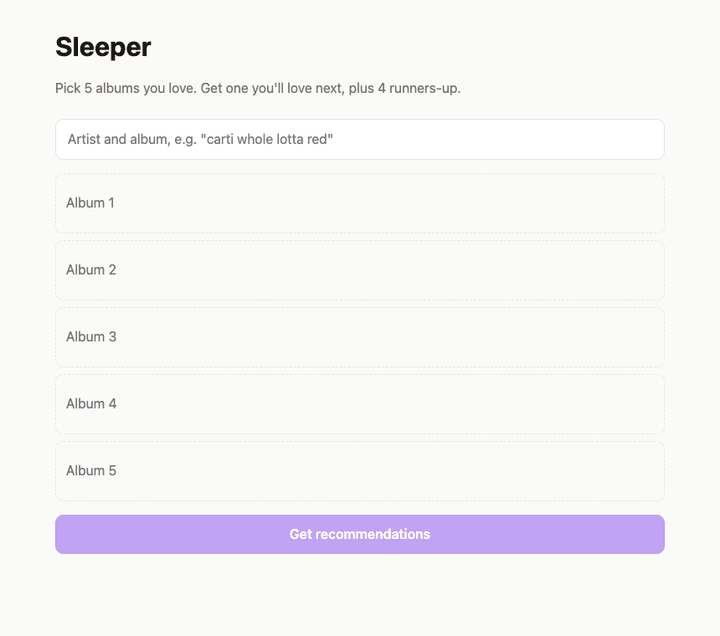

# Sleeper

Pick 5 albums you like and get 1 album to play next plus 4 runners-up, each with a one-line reason built from a scoring index.

**Live:** https://sleeper-pick.vercel.app/



> The backend runs on Render's free tier. It sleeps after 15 minutes without visitors and its cache is wiped when it does, so the first search can take about a minute and the first recommendations a few minutes. After that it's fast.

## How it works

The recommendation engine is the core of the project. Each step is a function in `backend/app/engine/`.

1. **Resolve** (`resolve.py`): each input is matched to one MusicBrainz *release group*, the ID shared by every edition of an album. Everything after this is keyed by that ID, not by name strings, so deluxe editions and remasters don't break matching. A match is rejected unless its artist and title closely resemble the input.
2. **Profile** (`profile.py`): each album's Last.fm tags are cleaned (lowercased; `hip-hop` = `hip hop`; junk like "seen live", "favorite", ratings and exact years removed; decades like "90s" kept). A tag's weight is the number of your 5 albums carrying it. Tags on 2 or more albums are **core**.
3. **Clusters** (`clusters.py`): if your picks split into unrelated groups (say 2 rap, 2 jazz and 1 shoegaze album), the engine recommends for the biggest group and tells you which albums it focused on. Two albums are linked if their tags share a meaningful word or one artist is on the other's similar-artists list.
4. **Candidates** (`candidates.py`): the top 5 albums of each input artist's 10 most similar artists, plus Last.fm's top albums for your 3 strongest tags. Your own artists are excluded.
5. **Score** (`score.py`): see the formula below. The engine then walks down the ranking and keeps one **studio album** per artist (checked on MusicBrainz, so no live albums, compilations or EPs).
6. **Explain** (`explain.py`): the reason is filled into a template from the core tags the pick matched and the input artists that led to it. There's no AI-generated text, so the reason always matches why the album ranked.

### Scoring

```
score = w1 · cosine(candidate tags, your tag profile)
      + w2 · (number of your artists whose similar-artist list includes it) / 5
      − w3 · popularity
```

- **cosine** compares the *mix* of tags (1.0 means the same tags in the same proportions), so an album isn't rewarded  for having more tags.
- **popularity** is the artist's listener count on a log scale from 0 to 1: 1,000 listeners → 0.43, 100,000 → 0.71, 2,000,000 → 0.90. It nudges results toward artists you may not know yet(which is why it's named sleeper pick)
- Weights start equal (`w1 = w2 = w3 = 1.0`) in one dict in `score.py`.
- Popularity is judged **per artist**: it decides which artists get suggested, while each artist's best-known album is tried first. If you don't know an artist yet, the record most people know will most likely be a natural place to start.

## Evaluation

`backend/eval/run_eval.py` does leave-one-out testing. Each eval set is 6 albums one listener likes. For each set, it hides one album, feeds the other 5 to the engine, and checks whether the hidden album appears in the top 20. It repeats that for all 6 albums in all 10 sets (60 runs).

| Version | Album hit rate | Artist hit rate* |
|---|---|---|
| Baseline | 35% | 73% |
| More albums per similar artist (2 → 5) and fixes | 32% | 78% |
| **Popularity per artist; best-known album first (current)** | **45%** | **78%** |

\* The right artist appeared in the top 20, with any of their albums.

Changing the popularity weight to anything from 0.5 to 1.5 gives the same result (45%), so the weight doesn't matter too much. The 10 sets cover rap, rage, digicore, hyperpop and art pop from 2015–2025. They lean toward well-known albums, which favors the "best-known album first" rule. 

## Data sources

| Source | Used for | Limits |
|---|---|---|
| [Last.fm API](https://www.last.fm/api) | tags, similar artists, top albums, listener counts | ≤ 5 requests/second |
| [MusicBrainz API](https://musicbrainz.org/doc/MusicBrainz_API) | album identity, release types, search | ≤ 1 request/second, descriptive User-Agent required |
| [Cover Art Archive](https://coverartarchive.org) | album covers (loaded by the browser) | |

Every API response goes through a SQLite cache (`backend/app/cache.py`), keyed by the endpoint plus the sorted request parameters. The API key is never stored in the cache. A rate limiter keeps each API under its limit, and cache hits skip it entirely. Nothing is scraped, and Spotify's recommendation endpoints aren't used.

## Stack

- **Backend:** Python 3.12, FastAPI, httpx, SQLite (stdlib `sqlite3`), pytest
- **Frontend:** React + Vite (plain JS)
- **Hosting:** Render (backend, free tier) and Vercel (frontend)

## Running locally

You need Python 3.11+, Node 20.19+ (or 22.12+) and a [Last.fm API key](https://www.last.fm/api/account/create).

**Backend**
```bash
cd backend
python3 -m venv .venv
.venv/bin/pip install -r requirements.txt
cp ../.env.example .env        # then fill in LASTFM_API_KEY and MB_USER_AGENT (use your email)
.venv/bin/uvicorn app.main:create_app --factory --reload   # http://localhost:8000/docs
```

**Frontend** (in a second terminal)
```bash
cd frontend
npm install
npm run dev                    # http://localhost:5173
```

In development, Vite forwards `/api/...` to the backend, so no extra setup is needed.

**Command line and tests** (from `backend/`)
```bash
.venv/bin/python scripts/recommend_cli.py "Slowdive - Souvlaki" "Ride - Nowhere" "Lush - Spooky" \
    "Cocteau Twins - Heaven or Las Vegas" "my bloody valentine - Loveless"
.venv/bin/python eval/run_eval.py                         # slow on the first run while the cache fills
.venv/bin/python eval/run_eval.py --weight popularity=0.5 # try other weights
.venv/bin/python -m pytest
```

## API

- `GET /search?q=carti whole lotta` returns up to 8 `{ mbid, title, artist, year, cover_url }`. Search works best with the artist plus the album, or the artist alone.
- `POST /recommend` with `{ "album_ids": [5 MusicBrainz release-group IDs] }` returns `{ main, runners_up[4], cluster_note }`. Each recommendation has `mbid, title, artist, year, cover_url, reason, listen_url, score`.
- Errors: `400` for anything other than 5 distinct valid IDs, `404` for unknown IDs, `502` when Last.fm or MusicBrainz fails.

## Deploying

- **Backend on Render:** `render.yaml` is a Blueprint. Choose New → Blueprint, then enter `LASTFM_API_KEY`, `MB_USER_AGENT` and `FRONTEND_ORIGIN` (your Vercel URL).
- **Frontend on Vercel:** set the root directory to `frontend` and set `VITE_API_URL` to the Render URL.

## Known limitations

- **Cold starts on the free tier:** the cache is wiped when the server sleeps, so the first recommendations after a nap take a few minutes.
- **Search** uses MusicBrainz, which doesn't rank by popularity: "carti whole lotta" works, but "whole lotta" alone may not.
- **Covers:** archive.org, which stores them, sometimes fails to serve an image. Those albums show a placeholder.
- **Last.fm aliases:** an old artist alias (such as "Travi$ Scott") can have its own page with a lower listener count, which makes that artist look less popular than it is.
